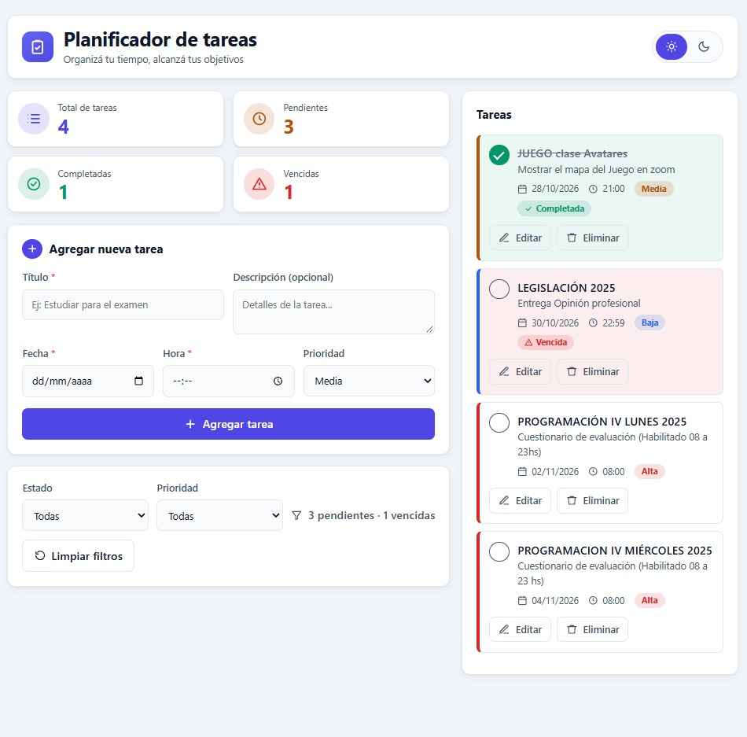
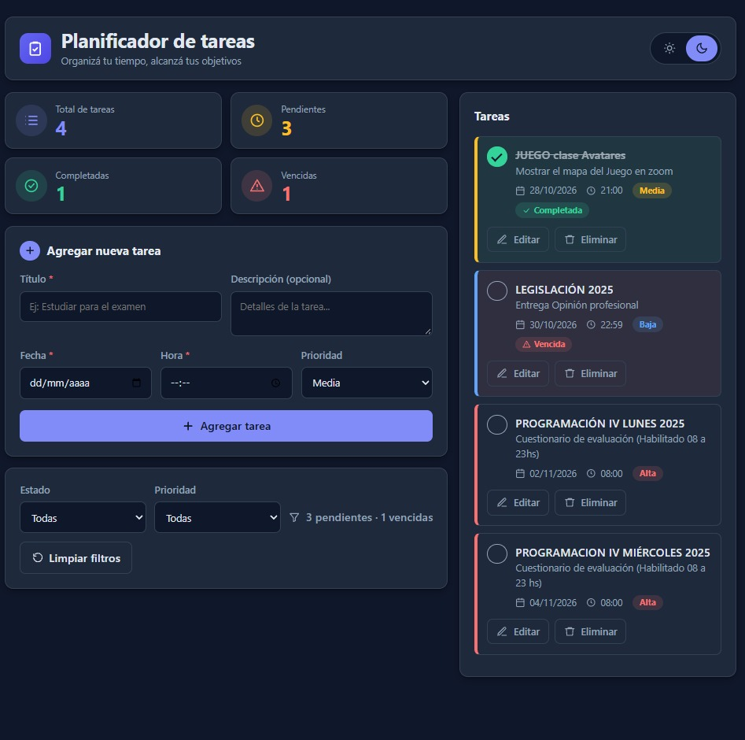
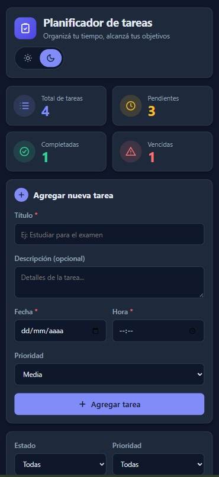
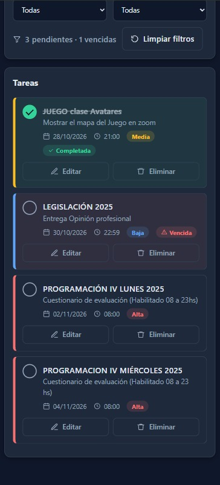

# Planificador de tareas

Aplicación web para planificar tareas: se crean, editan, filtran, se marcan como finalizadas y se eliminan. Las tareas se guardan en MySQL y se ordenan por fecha y hora.

Proyecto de las clases 10, 11 y 12 de Java del tutor Matías Carballo, basado en su proyecto ToDo ([repositorio de referencia](https://github.com/lokywolf2295/ToDo_Front_-_API)) y ampliado con mejoras propias por el grupo QWERTY123.

Vive en la carpeta `Java/Clase10-12/planificador_tareas/` del repositorio `Qwerty123-Cuarto-Semestre` de la organización HotCode2025.

## Capturas

La interfaz tiene tema claro y oscuro (el botón del encabezado cambia entre ambos y recuerda la elección). Arriba se ven los cuatro indicadores: total, pendientes, completadas y vencidas. Las tareas vencidas se marcan en rojo y las completadas en verde.

| Modo claro                                                          | Modo oscuro                                                           |
| ------------------------------------------------------------------- | --------------------------------------------------------------------- |
|  |  |

**Vista en celular** (modo oscuro): el diseño pasa a una sola columna, con el formulario arriba y la lista de tareas debajo.

| Formulario e indicadores                                                     | Lista de tareas                                                 |
| ---------------------------------------------------------------------------- | --------------------------------------------------------------- |
|  |  |

## Tecnologías

| Parte         | Tecnologías                                                                                   |
| ------------- | --------------------------------------------------------------------------------------------- |
| Backend       | Java 21, Spring Boot 3.3.5, Spring Data JPA, Bean Validation, Lombok                          |
| Base de datos | MySQL 8 (producción) y H2 en memoria (solo tests)                                             |
| Documentación | OpenAPI / Swagger UI (springdoc 2.6.0)                                                        |
| Frontend      | HTML, CSS y JavaScript puro, SweetAlert2 (por CDN), diseño responsive con tema claro y oscuro |
| Pruebas       | JUnit 5, Mockito, MockMvc, Postman                                                            |

## Estructura

```
planificador_tareas/
├── backend/
│   ├── pom.xml
│   └── src/
│       ├── main/java/com/tareas/planificador/
│       │   ├── PlanificadorApplication.java
│       │   ├── model/         Tarea, Prioridad
│       │   ├── dto/           TareaRequest, TareaResponse
│       │   ├── repository/    TareaRepository
│       │   ├── service/       TareaService
│       │   ├── controller/    TareaController
│       │   ├── exception/     GlobalExceptionHandler, TareaNoEncontradaException
│       │   └── config/        CorsConfig, OpenApiConfig
│       ├── main/resources/application.yml
│       └── test/              tests de service, controller y repository
├── frontend/                  index.html, css/styles.css, js/script.js
├── postman/                   colección de pruebas
├── docs/
│   ├── PLAN_COMMITS.md        plan de commits, tags y checklist
│   └── capturas/              imágenes que usa este README
└── README.md
```

La arquitectura del backend es por capas: **Controller → Service → Repository → base de datos**. El controller solo recibe y responde HTTP, el service concentra las reglas de negocio y el repository accede a los datos. La entidad nunca se expone directamente: se usan DTOs.

## Requisitos

- JDK 21
- Maven 3.9 o superior
- MySQL 8 corriendo en `localhost:3306`
- Un servidor estático para el front, por ejemplo la extensión **Live Server** de VS Code

## Cómo ejecutarlo

### 1. Obtener el proyecto

```bash
git clone https://github.com/HotCode2025/Qwerty123-Cuarto-Semestre.git
cd Qwerty123-Cuarto-Semestre
git switch respaldo-main
cd Java/Clase10-12/planificador_tareas
```

Una vez hecho el merge a `main`, se usa `main` en lugar de `respaldo-main`. Los comandos de los pasos siguientes se corren desde la carpeta `planificador_tareas`.

### 2. Variables de entorno

La conexión a MySQL toma usuario y contraseña del entorno, así no quedan escritos en el código:

| Variable      | Descripción         | Valor por defecto |
| ------------- | ------------------- | ----------------- |
| `DB_USER`     | Usuario de MySQL    | `root`            |
| `DB_PASSWORD` | Contraseña de MySQL | vacía             |

En IntelliJ: _Run → Edit Configurations → Environment variables_ (`DB_USER=root;DB_PASSWORD=tu_clave`).
En PowerShell: `$env:DB_USER="root"; $env:DB_PASSWORD="tu_clave"`.

El esquema `db_planificador_tareas` y la tabla `tareas` se crean solos al iniciar. Si tenés otro esquema con tablas del mismo nombre, no se toca: este proyecto usa su propio esquema.

### 3. Backend

```bash
cd backend
mvn spring-boot:run
```

La API queda en `http://localhost:8080`. Swagger UI: `http://localhost:8080/swagger-ui.html`.

En IntelliJ: clic derecho en `backend/pom.xml` → _Add as Maven Project_, y ejecutar `PlanificadorApplication`.

### 4. Frontend

Abrir `frontend/index.html` con Live Server (puerto 5500). El CORS del backend permite ese origen. Conviene abrir en VS Code la carpeta `planificador_tareas`, así Live Server sirve el front desde ahí.

## API

Base: `http://localhost:8080/api/v1/tareas`

| Método | Ruta                             | Descripción                                                                       | Respuesta |
| ------ | -------------------------------- | --------------------------------------------------------------------------------- | --------- |
| POST   | `/`                              | Crear una tarea                                                                   | 201       |
| GET    | `/`                              | Listar, con `?finalizada=true\|false` y `?prioridad=ALTA\|MEDIA\|BAJA` opcionales | 200       |
| GET    | `/{id}`                          | Obtener una tarea                                                                 | 200 / 404 |
| PUT    | `/{id}`                          | Editar una tarea                                                                  | 200 / 404 |
| PATCH  | `/{id}/finalizada/{true\|false}` | Marcar como finalizada o pendiente                                                | 200 / 404 |
| DELETE | `/{id}`                          | Eliminar una tarea                                                                | 204 / 404 |

Ejemplo de cuerpo para crear o editar:

```json
{
  "titulo": "Estudiar Spring Boot",
  "descripcion": "Repasar Service y Controller",
  "fecha": "2030-01-15",
  "hora": "18:30",
  "prioridad": "ALTA"
}
```

`titulo`, `fecha` y `hora` son obligatorios. Si no se envía `prioridad`, se asigna `MEDIA`. La respuesta incluye `finalizada` y `vencida` (pasó su fecha y hora sin completarse).

Los errores devuelven siempre el mismo formato:

```json
{
  "fecha": "2026-10-28T20:15:00",
  "estado": 400,
  "error": "Bad Request",
  "mensajes": ["titulo: El título es obligatorio"]
}
```

## Pruebas

**Tests automáticos** (no necesitan MySQL):

```bash
cd backend
mvn test
```

Son 11 tests: 5 de service (reglas de negocio), 5 de controller (códigos HTTP y validaciones) y 1 de repository (orden y filtros).

**Postman:** importar `postman/Planificador.postman_collection.json` y ejecutarla con _Run collection_. Con el backend corriendo, verifica creación, listado, filtros, edición, finalización, eliminación y los errores 400 y 404.

## Mejoras respecto al proyecto original

- Edición de tareas (`PUT`), que el original no tenía.
- Prioridad (alta, media, baja) y filtros por estado y prioridad.
- Indicador de tareas vencidas y contador de pendientes.
- Manejo de errores centralizado con `@RestControllerAdvice` y formato JSON uniforme.
- DTOs en lugar de exponer la entidad.
- Tests automáticos de las tres capas.
- Rutas REST en español y semánticamente correctas (`/tareas/{id}`).
- Panel de 4 indicadores en el front: total, pendientes, completadas y vencidas.
- Formulario con validación en línea: cada error aparece bajo su campo.
- Selector de tema claro/oscuro que recuerda la elección, y diseño en dos columnas que se adapta al celular.
- Front que construye el DOM con `textContent` (evita inyección de HTML en títulos y descripciones).
- `springdoc-openapi-starter-webmvc-ui`, compatible con Spring Boot 3 (el `springdoc-openapi-ui` del original es para Spring Boot 2).

## Agradecimientos

El grupo **QWERTY123** agradece a **Matías Carballo**, tutor de la Tecnicatura, que falleció este año. Este proyecto nace de su ToDo ([ToDo*Front*-\_API](https://github.com/lokywolf2295/ToDo_Front_-_API)): de él tomamos la idea y la base, y desde ahí lo ampliamos con mejoras propias. Gracias por enseñar con tanta generosidad. Este trabajo es también un homenaje a su recuerdo.

## Flujo de trabajo con Git

El proyecto se armó en la rama `respaldo-main`, con un issue por cada parte (#265 a #276 del repositorio) y commits con `refs #N`. El detalle de commits, tags (`planificador-v0.1.0` a `planificador-v1.1.0`) y la checklist de verificación está en [docs/PLAN_COMMITS.md](docs/PLAN_COMMITS.md).
